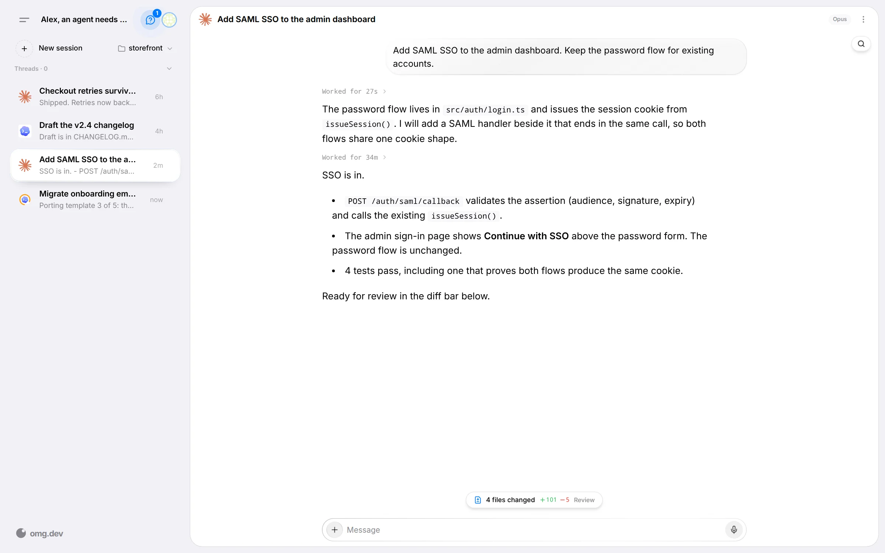

# omg.dev

**Build your ideas on the go.**

Give your agents a task from your phone. Get a notification when the result is
ready. Your laptop can stay closed.

Open-source harness for Claude Code, Codex, and other coding agents. Run it on
your own computer or your own server. Free and MIT licensed.

Built by the team behind [omg.dev](https://omg.dev).

[](./LICENSE)
[](https://github.com/BennyKok/omg.dev/releases)
[](https://github.com/BennyKok/omg.dev/releases/download/desktop-preview/macos-arm64-omg.dev.dmg)
[](https://omg.dev/discord)

<p align="center">
  
</p>

Use the agent subscription you already pay for, such as Claude or ChatGPT.

## Install on your computer

Debian, Ubuntu, or macOS. No account needed. On Linux, a normal user with
`sudo`. Do not run as `root`.

1. Install [Bun](https://bun.sh) if you do not have it:

   ```bash
   curl -fsSL https://bun.sh/install | bash
   ```

   Open a new terminal after this step.

2. Install omg.dev and start it as a background service:

   ```bash
   bun install --global @omg-dev/cli && omg computer setup
   ```

3. Open [http://localhost:8766](http://localhost:8766).

Setup needs `git` and `curl`. On Linux it installs them when they are missing.
On macOS, install them yourself or run setup with `OMG_INSTALL_SYSTEM_DEPS=1`
to use Homebrew. `tmux` and `jq` are not required.

Open **Settings → Coding agents**. Supports Claude Code, Codex, Grok, Cursor,
omg agent, OpenCode, fx, Muse, DeepSeek, Devin, Jcode, Copilot, and Pi. Sign in
with the agent provider.

### Try the macOS desktop preview

Apple Silicon. Ships with its own runtime. No separate CLI install.

[**Download omg.dev for macOS →**](https://github.com/BennyKok/omg.dev/releases/download/desktop-preview/macos-arm64-omg.dev.dmg)

Unsigned preview. Control-click the app, choose **Open**, then **Open** again.
Or **System Settings → Privacy & Security → Open Anyway**.

## What you get

- Several coding-agent sessions in parallel.
- Transcripts and follow-ups in the web UI.
- Chat, Bots, Schedules, and Notifications in one place.
- Managed sessions keep running when the UI disconnects.
- Your existing agent subscriptions or API keys.

## Remote access and security

The local server binds to `127.0.0.1` and has no built-in authentication. Do
not expose it to the public internet.

Phone access through Tailscale:

```bash
OMG_TAILSCALE_SERVE=1 omg computer setup
```

Sign in to Tailscale if setup asks. See [remote access](./docs/remote-access.md)
and [SECURITY.md](./SECURITY.md) before you share access.

## Manage a local install

```bash
omg computer start     # start the background service
omg computer status    # check the install
omg computer update    # install the latest release
omg computer update --restart  # restart the service, no download
omg doctor             # create a sanitized diagnostic report
omg computer uninstall # remove omg.dev and keep sessions and config
```

## Develop from source

```bash
git clone https://github.com/BennyKok/omg.dev.git
cd omg.dev
bun install
cp .env.example .env
bun run serve
```

API is at [http://localhost:8766](http://localhost:8766). For the UI, run
`cd web && bun run dev` in another terminal. `bun run serve` alone needs a
built `web/dist`.

Desktop shell: [desktop development](./desktop/README.md).

Read [CONTRIBUTING.md](./CONTRIBUTING.md) before a pull request. Help:
[Discord](https://omg.dev/discord).

## License

[MIT](./LICENSE)
